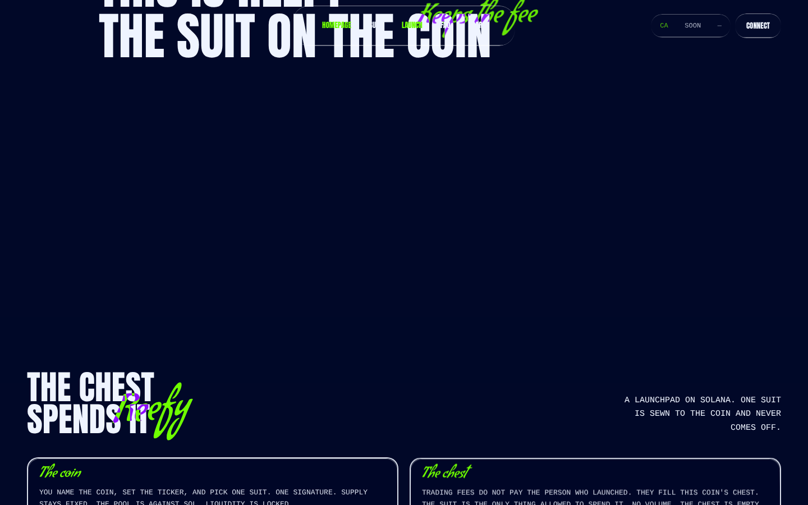
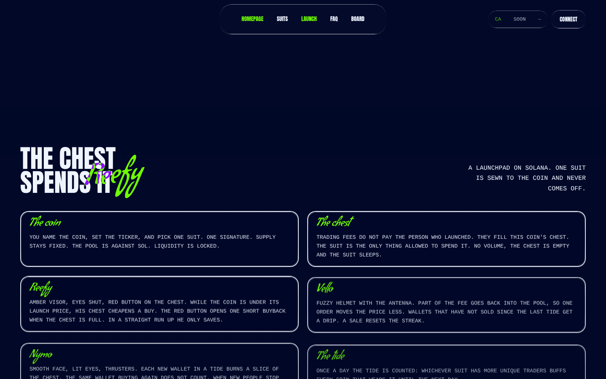
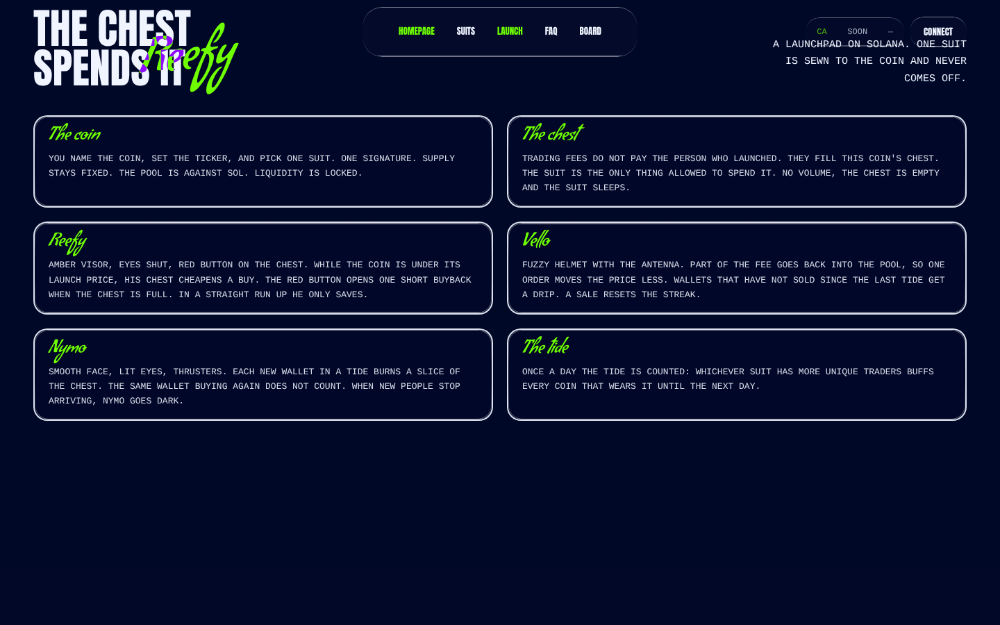
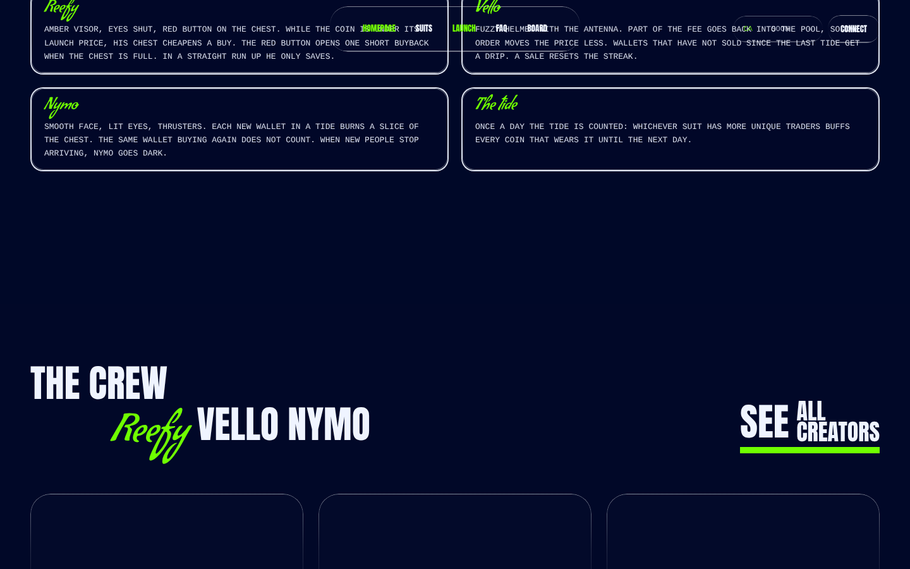
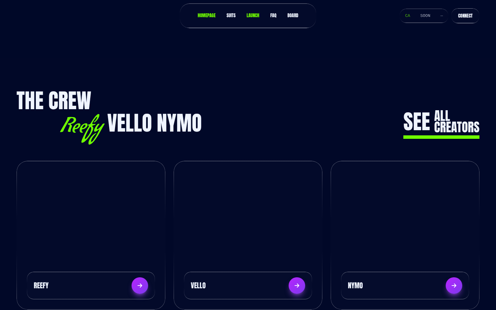
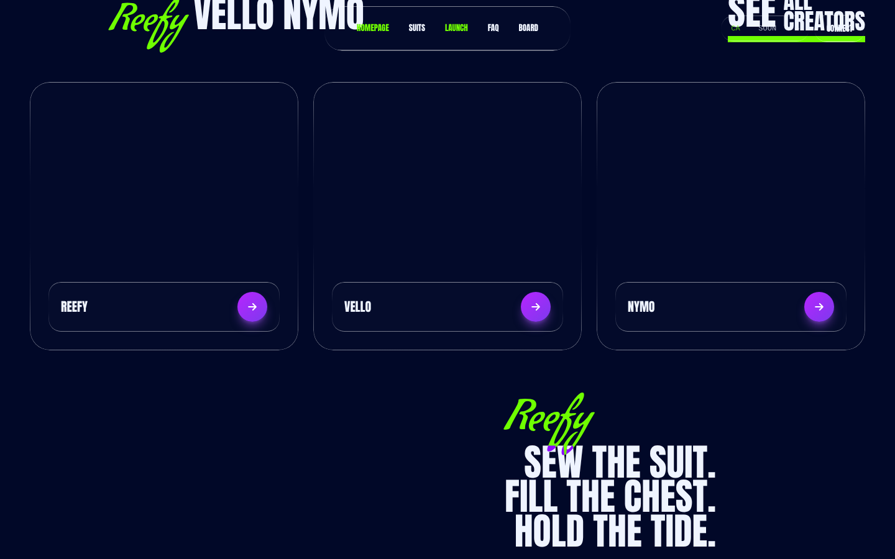
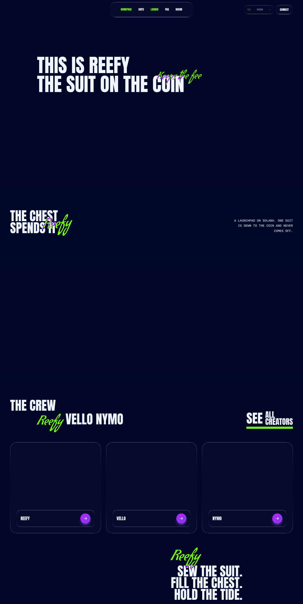
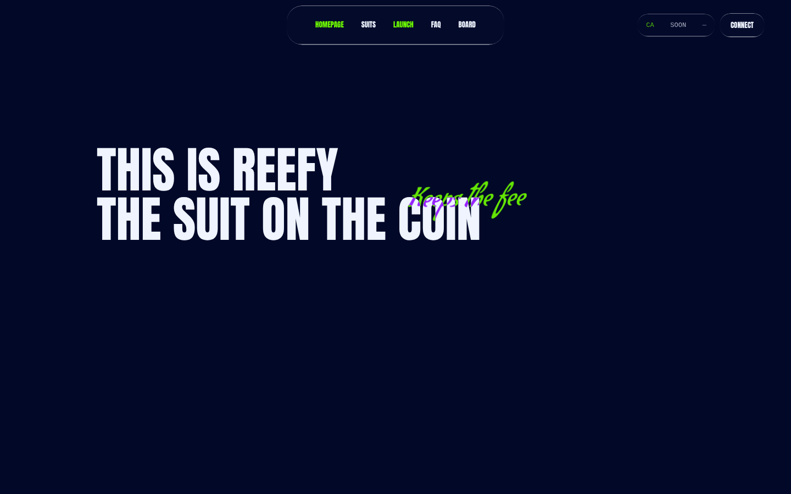

# reefy Design System

You are building UI for **reefy**. Light-themed, neutral palette, sans-serif typography (Anton), compact density on a 4px grid.

## Visual Reference

**IMPORTANT**: Study ALL screenshots below before writing any UI. Match colors, typography, spacing, layout, and motion exactly as shown.

### Scroll Journey (Cinematic Visual States)

> These screenshots capture the website at different scroll depths. The design changes dramatically as you scroll — each frame shows a different cinematic state. Replicate these exact visual transitions.

#### 0% — Hero / Above the fold


#### 17% — Mid-page at 17% scroll



#### 33% — Mid-page at 33% scroll



#### 50% — Mid-page at 50% scroll



#### 67% — Mid-page at 67% scroll



#### 83% — Mid-page at 83% scroll



#### 100% — Footer / End of page



### Video Backgrounds (First Frames)


> Read `references/DESIGN.md` for full token details. Read `references/ANIMATIONS.md` for motion specs. Read `references/LAYOUT.md` for layout structure. Read `references/COMPONENTS.md` for component patterns.

## Ultra Reference Files

This package includes extended documentation. **Read these files before implementing:**

| File | Contents |
|------|----------|
| `references/DESIGN.md` | Full design system tokens, colors, typography, spacing |
| `references/VISUAL_GUIDE.md` | **START HERE** — Master visual guide with all screenshots embedded |
| `references/ANIMATIONS.md` | CSS keyframes, scroll triggers, motion library stack, video specs |
| `references/LAYOUT.md` | Flex/grid containers, page structure, spacing relationships |
| `references/COMPONENTS.md` | DOM component patterns, HTML structure, class fingerprints |
| `references/INTERACTIONS.md` | Hover/focus states with before/after style diffs |
| `screens/scroll/` | 7 scroll journey screenshots showing cinematic states |

### Animation Stack Detected

- **Web Animations API (3 active)** — animation

## Design Philosophy

- **Layered depth** — use shadow tokens to create a sense of physical layering. Each elevation level has a specific shadow.
- **Gradient accents** — gradients are used thoughtfully for emphasis, not decoration.
- **Type pairing** — Anton for body/UI text, Condiment for headings/display. Never introduce a third typeface.
- **compact density** — 4px base grid. Every dimension is a multiple of 4.
- **neutral palette** — the color temperature runs neutral, matching the sans-serif typography.
- **Subtle motion** — transitions smooth state changes. Keep durations under 300ms, use ease-out curves.

## Color System

### Core Palette

| Role | Token | Hex | Use |
|------|-------|-----|-----|
| Background | `--background` | `#ffffff` | Page/app background |
| Surface | `--surface` | `#eff4ff` | Cards, panels, modals |
| Text Primary | `--text-primary` | `#010828` | Headings, body text |
| Text Muted | `--text-muted` | `#9ca3af` | Captions, placeholders |

### Status Colors

| Status | Hex | Use |
|--------|-----|-----|
| Success | `#6fff00` | Confirmations, positive trends |

### Extended Palette

- `#e5e7eb` — Light surface or highlight color
- **tw-ring-color:** `#3b82f6`

## Typography

### Font Stack

- **Anton** — Heading 1, Heading 2, Heading 3
- **Condiment** — Body, Caption
- **SFMono-Regular** — Code

### Font Sources

```css
@font-face {
  font-family: "Anton";
  src: url("fonts/Anton-Regular.ttf") format("truetype");
  font-weight: 400;
}
@font-face {
  font-family: "Condiment";
  src: url("fonts/Condiment-Regular.ttf") format("truetype");
  font-weight: 400;
}
```

### Type Scale

| Role | Family | Size | Weight |
|------|--------|------|--------|
| Heading 1 | Anton | 90px | 700 |
| Heading 2 | Anton | 75px | 700 |
| Heading 3 | Anton | 68px | 700 |
| Body | Condiment | 16px | 400 |
| Caption | Condiment | 13px | 400 |
| Code | SFMono-Regular | 14px | 400 |

### Typography Rules

- Body/UI: **Anton**, Headings: **Condiment** — these are the only display fonts
- Max 3-4 font sizes per screen
- Headings: weight 600-700, body: weight 400
- Use color and opacity for text hierarchy, not additional font sizes
- Line height: 1.5 for body, 1.2 for headings

## Spacing & Layout

### Base Grid: 4px

Every dimension (margin, padding, gap, width, height) must be a multiple of **4px**.

### Spacing Scale

`4, 8, 12, 16, 18, 20, 24, 30, 32, 40, 48, 52` px

### Spacing as Meaning

| Spacing | Use |
|---------|-----|
| 4-8px | Tight: related items (icon + label, avatar + name) |
| 12-16px | Medium: between groups within a section |
| 24-32px | Wide: between distinct sections |
| 48px+ | Vast: major page section breaks |

### Border Radius

Scale: `inherit, 0px 0px 32px 32px, 12px, 16px, 20px, 24px, 28px, 32px`
Default: `20px`

## Component Patterns

### Card

```css
.card {
  background: #eff4ff;
  border-radius: 20px;
  padding: 16px;
  box-shadow: inset 0 1px 1px #ffffff1a;
}
```

```html
<div class="card">
  <h3>Card Title</h3>
  <p>Card content goes here.</p>
</div>
```

### Button

```css
/* Primary */
.btn-primary {
  background: #cccccc;
  color: #010828;
  border-radius: 20px;
  padding: 8px 16px;
  font-weight: 500;
  transition: opacity 150ms ease;
}
.btn-primary:hover { opacity: 0.9; }

/* Ghost */
.btn-ghost {
  background: transparent;
  border: 1px solid #cccccc;
  color: #010828;
  border-radius: 20px;
  padding: 8px 16px;
}
```

```html
<button class="btn-primary">Get Started</button>
<button class="btn-ghost">Learn More</button>
```

### Input

```css
.input {
  background: #ffffff;
  border: 1px solid #cccccc;
  border-radius: 20px;
  padding: 8px 12px;
  color: #010828;
  font-size: 14px;
}
.input:focus { border-color: var(--accent); outline: none; }
```

```html
<input class="input" type="text" placeholder="Search..." />
```

### Badge / Chip

```css
.badge {
  display: inline-flex;
  align-items: center;
  padding: 4px 8px;
  border-radius: 9999px;
  font-size: 12px;
  font-weight: 500;
  background: #eff4ff;
  color: #9ca3af;
}
```

```html
<span class="badge">New</span>
<span class="badge">Beta</span>
```

### Modal / Dialog

```css
.modal-backdrop { background: rgba(0, 0, 0, 0.6); }
.modal {
  background: #eff4ff;
  border-radius: 32px;
  padding: 24px;
  max-width: 480px;
  width: 90vw;
  box-shadow: rgba(0, 0, 0, 0) 0px 0px 0px 0px, rgba(0, 0, 0, 0) 0px 0px 0px 0px, rgba(168, 85, 247, 0.5) 0px 10px 15px -3px, rgba(168, 85, 247, 0.5) 0px 4px 6px -4px;
}
```

```html
<div class="modal-backdrop">
  <div class="modal">
    <h2>Dialog Title</h2>
    <p>Dialog content.</p>
    <button class="btn-primary">Confirm</button>
    <button class="btn-ghost">Cancel</button>
  </div>
</div>
```

### Table

```css
.table { width: 100%; border-collapse: collapse; }
.table th {
  text-align: left;
  padding: 8px 12px;
  font-weight: 500;
  font-size: 12px;
  color: #9ca3af;
  text-transform: uppercase;
  letter-spacing: 0.05em;
  border-bottom: 1px solid #cccccc;
}
.table td {
  padding: 12px;
  border-bottom: 1px solid #cccccc;
}
```

```html
<table class="table">
  <thead><tr><th>Name</th><th>Status</th><th>Date</th></tr></thead>
  <tbody>
    <tr><td>Item One</td><td>Active</td><td>Jan 1</td></tr>
    <tr><td>Item Two</td><td>Pending</td><td>Jan 2</td></tr>
  </tbody>
</table>
```

### Navigation

```css
.nav {
  display: flex;
  align-items: center;
  gap: 8px;
  padding: 12px 16px;
}
.nav-link {
  color: #9ca3af;
  padding: 8px 12px;
  border-radius: 20px;
  transition: color 150ms;
}
.nav-link:hover { color: #010828; }
```

```html
<nav class="nav">
  <a href="/" class="nav-link active">Home</a>
  <a href="/about" class="nav-link">About</a>
  <a href="/pricing" class="nav-link">Pricing</a>
  <button class="btn-primary" style="margin-left: auto">Get Started</button>
</nav>
```

## Animation & Motion

This project uses **subtle motion**. Transitions smooth state changes without calling attention.

### CSS Animations

- `hero-rise`
- `hero-script`
- `toast-rise`
- `ca-check`

### Motion Tokens

- **Duration scale:** `.15s`, `.7s`
- **Easing functions:** `cubic-bezier(.4,0,.2,1)`, `cubic-bezier(0,0,.2,1)`

### Motion Guidelines

- **Duration:** Use values from the duration scale above. Short (.15s) for micro-interactions, long (.7s) for page transitions
- **Easing:** Use `cubic-bezier(.4,0,.2,1)` as the default easing curve
- **Direction:** Elements enter from bottom/right, exit to top/left
- **Reduced motion:** Always respect `prefers-reduced-motion` — disable animations when set

## Depth & Elevation

### Shadow Tokens

- Subtle: `inset 0 1px 1px #ffffff1a`
- Subtle: `rgba(255, 255, 255, 0.1) 0px 1px 1px 0px inset`
- Floating (dropdowns, popovers): `rgba(0, 0, 0, 0) 0px 0px 0px 0px, rgba(0, 0, 0, 0) 0px 0px 0px 0px, rgba(168, 85, 247, 0.5) 0px 10px 15px -3px, rgba(168, 85, 247, 0.5) 0px 4px 6px -4px`

### Z-Index Scale

`0, 10, 40, 50`

Use these exact values — never invent z-index values.

## Anti-Patterns (Never Do)

- **No blur effects** — no backdrop-blur, no filter: blur()
- **No zebra striping** — tables and lists use borders for separation
- **No invented colors** — every hex value must come from the palette above
- **No arbitrary spacing** — every dimension is a multiple of 4px
- **No extra fonts** — only Anton and Condiment and SFMono-Regular are allowed
- **No arbitrary border-radius** — use the scale: 12px, 16px, 20px, 24px, 28px, 32px
- **No opacity for disabled states** — use muted colors instead

## Workflow

1. **Read** `references/DESIGN.md` before writing any UI code
2. **Pick colors** from the Color System section — never invent new ones
3. **Set typography** — Anton, Condiment, SFMono-Regular only, using the type scale
4. **Build layout** on the 4px grid — check every margin, padding, gap
5. **Match components** to patterns above before creating new ones
6. **Apply elevation** — use shadow tokens
7. **Validate** — every value traces back to a design token. No magic numbers.

## Brand Spec

- **Favicon:** `/favicon.png`
- **Site URL:** `https://reefy.cash`
- **Brand typeface:** Anton

## Quick Reference

```
Background:     #ffffff
Surface:        #eff4ff
Text:           #010828 / #9ca3af
Accent:         (not extracted)
Border:         (not extracted)
Font:           Anton
Spacing:        4px grid
Radius:         20px
Components:     0 detected
```

## When to Trigger

Activate this skill when:
- Creating new components, pages, or visual elements for reefy
- Writing CSS, Tailwind classes, styled-components, or inline styles
- Building page layouts, templates, or responsive designs
- Reviewing UI code for design consistency
- The user mentions "reefy" design, style, UI, or theme
- Generating mockups, wireframes, or visual prototypes

---

# Full Reference Files

> Every output file is embedded below. Claude has full design system context from /skills alone.

## Design System Tokens (DESIGN.md)

# reefy DESIGN.md

> Auto-generated design system — reverse-engineered via static analysis by skillui.
> Frameworks: None detected
> Colors: 7 · Fonts: 3 · Components: 0
> Icon library: not detected · State: not detected
> Primary theme: light · Dark mode toggle: no · Motion: subtle

---

## 1. Visual Theme & Atmosphere

This is a **light-themed** interface with a neutral, approachable feel. The light background emphasizes content clarity. Typography pairs **Condiment** for display/headings with **Anton** for body text, creating clear visual hierarchy through type contrast. Spacing follows a **4px base grid** (compact density), with scale: 4, 8, 12, 16, 18, 20, 24, 30px. Motion is subtle — smooth transitions (150-300ms) ease state changes without drawing attention.

---

## 2. Color Palette & Roles

| Token | Hex | Role | Use |
|---|---|---|---|
| tw-ring-offset-color | `#ffffff` | background | Page background, darkest surface |
| surface | `#eff4ff` | surface | Card and panel backgrounds |
| text-primary | `#010828` | text-primary | Headings and body text |
| text-muted | `#9ca3af` | text-muted | Captions, placeholders, secondary info |
| success | `#6fff00` | success | Success states, positive indicators |
| tw-ring-color | `#3b82f6` | info | Informational highlights |
| unknown | `#e5e7eb` | unknown | Palette color |

### CSS Variable Tokens

```css
--tw-border-spacing-x: 0;
--tw-border-spacing-y: 0;
--tw-border-opacity: 1;
```


---

## 3. Typography Rules

**Font Stack:**
- **Anton** — Heading 1, Heading 2, Heading 3
- **Condiment** — Body, Caption
- **SFMono-Regular** — Code

**Font Sources:**

```css
@font-face {
  font-family: "Anton";
  src: url("fonts/Anton-Regular.ttf") format("truetype");
  font-weight: 400;
}
@font-face {
  font-family: "Condiment";
  src: url("fonts/Condiment-Regular.ttf") format("truetype");
  font-weight: 400;
}
```

| Role | Font | Size | Weight |
|---|---|---|---|
| Heading 1 | Anton | 90px | 700 |
| Heading 2 | Anton | 75px | 700 |
| Heading 3 | Anton | 68px | 700 |
| Body | Condiment | 16px | 400 |
| Caption | Condiment | 13px | 400 |
| Code | SFMono-Regular | 14px | 400 |

**Typographic Rules:**
- Limit to 3 font families max per screen
- Use **Anton** for body/UI text, **Condiment** for display/headings
- Maintain consistent hierarchy: no more than 3-4 font sizes per screen
- Headings use bold (600-700), body uses regular (400)
- Line height: 1.5 for body text, 1.2 for headings
- Use color and opacity for secondary hierarchy, not additional font sizes


---

## 4. Component Stylings

No components detected. Scan `src/components/` or `components/` to populate this section.

---

## 5. Layout Principles

- **Base spacing unit:** 4px
- **Spacing scale:** 4, 8, 12, 16, 18, 20, 24, 30, 32, 40, 48, 52
- **Border radius:** inherit, 0px 0px 32px 32px, 12px, 16px, 20px, 24px, 28px, 32px

**Spacing as Meaning:**
| Spacing | Use |
|---|---|
| 4-8px | Tight: related items within a group |
| 12-16px | Medium: between groups |
| 24-32px | Wide: between sections |
| 48px+ | Vast: major section breaks |


---

## 6. Depth & Elevation

### Flat — subtle depth hints

- `inset 0 1px 1px #ffffff1a`
- `rgba(255, 255, 255, 0.1) 0px 1px 1px 0px inset`

### Floating — dropdowns, popovers, modals

- `rgba(0, 0, 0, 0) 0px 0px 0px 0px, rgba(0, 0, 0, 0) 0px 0px 0px 0px, rgba(168, 85, 247, 0.5) 0px 10px 15px -3px, rgba(168, 85, 247, 0.5) 0px 4px 6px -4px`

### Z-Index Scale

`0, 10, 40, 50`


---

## 7. Animation & Motion

This project uses **subtle motion**. Transitions smooth state changes without demanding attention.

### CSS Animations

- `@keyframes hero-rise`
- `@keyframes hero-script`
- `@keyframes toast-rise`
- `@keyframes ca-check`

### Motion Guidelines

- Duration: 150-300ms for micro-interactions, 300-500ms for page transitions
- Easing: `ease-out` for enters, `ease-in` for exits
- Always respect `prefers-reduced-motion`


---

## 8. Do's and Don'ts

### Do's

- Use `#ffffff` as the primary page background
- Pair **Anton** (body) with **Condiment** (display) — these are the only allowed fonts
- Follow the **4px** spacing grid for all margins, padding, and gaps
- Use the defined shadow tokens for elevation — see Section 6
- Use border-radius from the scale: inherit, 0px 0px 32px 32px, 12px, 16px, 20px

### Don'ts

- Don't introduce colors outside this palette — extend the design tokens first
- Don't introduce additional font families beyond Anton and Condiment and SFMono-Regular
- Don't use arbitrary spacing values — stick to multiples of 4px
- Don't create custom box-shadow values outside the system tokens
- Don't use arbitrary border-radius values — pick from the defined scale
- Don't use backdrop-blur or blur effects

### Anti-Patterns (detected from codebase)

- No blur or backdrop-blur effects
- No zebra striping on tables/lists


---

## 9. Responsive Behavior

No breakpoints detected. Consider adding responsive breakpoints to the design system.

---

## 10. Agent Prompt Guide

Use these as starting points when building new UI:

### Build a Card

```
Background: #eff4ff
Border: 1px solid var(--border)
Radius: 20px
Padding: 16px
Font: Anton
Use shadow tokens from Section 6.
```

### Build a Button

```
Primary: bg var(--accent), text white
Ghost: bg transparent, border var(--border)
Padding: 8px 16px
Radius: 20px
Hover: opacity 0.9 or lighter shade
Focus: ring with var(--accent)
```

### Build a Page Layout

```
Background: #ffffff
Max-width: 1280px, centered
Grid: 4px base
Responsive: mobile-first, breakpoints from Section 9
```

### Build a Stats Card

```
Surface: #eff4ff
Label: #9ca3af (muted, 12px, uppercase)
Value: #010828 (primary, 24-32px, bold)
Status: use success/warning/danger from Section 2
```

### Build a Form

```
Input bg: #ffffff
Input border: 1px solid var(--border)
Focus: border-color var(--accent)
Label: #9ca3af 12px
Spacing: 16px between fields
Radius: 20px
```

### General Component

```
1. Read DESIGN.md Sections 2-6 for tokens
2. Colors: only from palette
3. Font: Anton, type scale from Section 3
4. Spacing: 4px grid
5. Components: match patterns from Section 4
6. Elevation: shadow tokens
```

## Visual Guide — Screenshots (VISUAL_GUIDE.md)

# reefy — Visual Guide

> Master visual reference. Study every screenshot carefully before implementing any UI.
> Match colors, layout, typography, spacing, and motion states exactly.

**Motion Stack:** **Web Animations API (3 active)**

## Scroll Journey

The page has cinematic scroll animations. Each screenshot below shows the exact visual state at that scroll depth.
**Replicate these transitions precisely** — the design changes dramatically as you scroll.

### Hero — Above the fold

*Scroll position: 0px of 2868px total*


### 17% scroll depth

*Scroll position: 335px of 2868px total*


### 33% scroll depth

*Scroll position: 649px of 2868px total*


### 50% scroll depth

*Scroll position: 984px of 2868px total*


### 67% scroll depth

*Scroll position: 1319px of 2868px total*


### 83% scroll depth

*Scroll position: 1633px of 2868px total*


### Footer — End of page

*Scroll position: 1968px of 2868px total*


## Video Backgrounds

These videos play as background elements. Use first-frame as poster image while video loads.

### Video 1 (background)

*Source: `https://d8j0ntlcm91z4.cloudfront.net/user_38xzZboKViGWJOttwIXH07lWA1P/hf_2026033...`*


## Full Page Screenshots

### Reefy

*URL: `https://reefy.cash`*


## Section Screenshots

Clipped sections showing individual components in context.

### Section 1 — `section`

*1440×900px*


## Animations & Motion (ANIMATIONS.md)

# Animation Reference

> Cinematic motion design extracted from live DOM. Follow these specs exactly to recreate the experience.

## Motion Technology Stack

| Library | Type | Notes |
|---------|------|-------|
| **Web Animations API (3 active)** | animation |  |

## Scroll Journey

The page is **2,868px** tall. Each frame below shows what the user sees at that scroll depth.

> **Use these screenshots to understand WHAT animates, WHEN it animates, and HOW it moves.**

### 0% — Top / Hero
Scroll position: 0px


### 17% — Opening Section
Scroll position: 335px


### 33% — First Feature Section
Scroll position: 649px


### 50% — Mid-Page
Scroll position: 984px


### 67% — Lower Content
Scroll position: 1,319px


### 83% — Near Footer
Scroll position: 1,633px


### 100% — Bottom / Footer
Scroll position: 1,968px


## Video Elements

| # | Role | Autoplay | Loop | Muted | Size | First Frame |
|---|------|----------|------|-------|------|-------------|
| 1 | background | ✓ | ✓ | ✓ | 1440×900 | [view](../screens/scroll/video-1-frame.png) |
| 2 | background | ✓ | ✓ | ✓ | 1440×900 | — |
| 3 | content | ✓ | ✓ | ✓ | 396×396 | — |
| 4 | content | ✓ | ✓ | ✓ | 396×396 | — |
| 5 | content | ✓ | ✓ | ✓ | 396×396 | — |
| 6 | background | ✓ | ✓ | ✓ | 1440×150 | — |

**Video 1 first frame:**


- **Source:** `https://d8j0ntlcm91z4.cloudfront.net/user_38xzZboKViGWJOttwIXH07lWA1P/hf_20260331_045634_e1c98c76-1265-4f5c-882a-4276f20`
- **Source:** `https://d8j0ntlcm91z4.cloudfront.net/user_38xzZboKViGWJOttwIXH07lWA1P/hf_20260331_151551_992053d1-3d3e-4b8c-abac-45f2215`
- **Source:** `https://d8j0ntlcm91z4.cloudfront.net/user_38xzZboKViGWJOttwIXH07lWA1P/hf_20260331_053923_22c0a6a5-313c-474c-85ff-3b50d25`
- **Source:** `https://d8j0ntlcm91z4.cloudfront.net/user_38xzZboKViGWJOttwIXH07lWA1P/hf_20260331_054411_511c1b7a-fb2f-42ef-bf6c-32c0b1a`
- **Source:** `https://d8j0ntlcm91z4.cloudfront.net/user_38xzZboKViGWJOttwIXH07lWA1P/hf_20260331_055427_ac7035b5-9f3b-4289-86fc-941b243`
- **Source:** `https://d8j0ntlcm91z4.cloudfront.net/user_38xzZboKViGWJOttwIXH07lWA1P/hf_20260331_055729_72d66327-b59e-4ae9-bb70-de6ccb5`

## CSS Keyframes (4 extracted)

### `@keyframes hero-rise`

Duration: `0.95s` · Easing: `cubic-bezier(0.16, 1, 0.3, 1)` · Delay: `0s` · Iteration: `1` · Fill: `both`

Used by: `.hero-line`

```css
@keyframes hero-rise {
  0% {
    opacity: 0;
    filter: blur(10px);
    transform: translateY(42px);
  }
  100% {
    opacity: 1;
    filter: blur();
    transform: translateY(0px);
  }
}
```

> Fade + motion enter animation · Filter effect (blur/brightness)

### `@keyframes hero-script`

Duration: `0.9s` · Easing: `cubic-bezier(0.16, 1, 0.3, 1)` · Delay: `0.46s` · Iteration: `1` · Fill: `both`

Used by: `.hero-script`

```css
@keyframes hero-script {
  0% {
    opacity: 0;
    filter: blur(8px);
    transform: translateY(16px) rotate(-14deg) scale(0.82);
  }
  100% {
    opacity: 0.9;
    filter: blur();
    transform: translateY(0px) rotate(-1deg) scale(1);
  }
}
```

> Fade + motion enter animation · Filter effect (blur/brightness)

### `@keyframes toast-rise`

Duration: `0.35s` · Easing: `cubic-bezier(0.16, 1, 0.3, 1)` · Delay: `0s` · Iteration: `1` · Fill: `both`

Used by: `.toast-rise`

```css
@keyframes toast-rise {
  0% {
    opacity: 0;
    transform: translateY(16px);
  }
  100% {
    opacity: 1;
    transform: translateY(0px);
  }
}
```

> Fade + motion enter animation

### `@keyframes ca-check`

Duration: `0.22s` · Easing: `cubic-bezier(0.16, 1, 0.3, 1)` · Delay: `0s` · Iteration: `1` · Fill: `both`

Used by: `.ca-check`

```css
@keyframes ca-check {
  0% {
    opacity: 0;
    transform: translate(-50%, 8px) scale(0.8);
  }
  100% {
    opacity: 1;
    transform: translate(-50%) scale(1);
  }
}
```

> Fade + motion enter animation

## How to Recreate This Motion Design

### Step 1 — Install Dependencies

```bash
```

### Step 2 — Scroll-Reveal Pattern

Elements that animate into view follow this pattern:

```css
/* Initial hidden state */
.reveal {
  opacity: 0;
  transform: translateY(40px);
  transition: opacity 0.6s cubic-bezier(0.4, 0, 0.2, 1),
              transform 0.6s cubic-bezier(0.4, 0, 0.2, 1);
}
.reveal.visible {
  opacity: 1;
  transform: translateY(0);
}
```

### Step 3 — Key Motion Principles

- **Video backgrounds** — use `<video autoplay loop muted playsinline>` for background videos. Always include a poster image fallback
- **Always add** `@media (prefers-reduced-motion: reduce) { * { animation-duration: 0.01ms !important; transition-duration: 0.01ms !important; } }`

### Step 4 — Scroll Journey Reference

Match what happens at each scroll position:

- **0%** (`0px`) → `screens/scroll/scroll-000.png`
- **17%** (`335px`) → `screens/scroll/scroll-017.png`
- **33%** (`649px`) → `screens/scroll/scroll-033.png`
- **50%** (`984px`) → `screens/scroll/scroll-050.png`
- **67%** (`1319px`) → `screens/scroll/scroll-067.png`
- **83%** (`1633px`) → `screens/scroll/scroll-083.png`
- **100%** (`1968px`) → `screens/scroll/scroll-100.png`

## Layout & Grid (LAYOUT.md)

# Layout Reference

> Auto-extracted from live DOM. Use this to understand how the site is structured spatially.

## Spacing System

**Base grid:** 4px

**Scale:** `4, 8, 12, 16, 18, 20, 24, 30, 32, 40, 48, 52, 64, 80, 96` px

| Spacing | Semantic Use |
|---------|-------------|
| 4px | Tight — within a component |
| 8px | Medium — between sibling items |
| 16px | Wide — between sections |
| 32px | Vast — major section breaks |

## Flex Layouts

| Element | Direction | Justify | Align | Gap | Children |
|---------|-----------|---------|-------|-----|----------|
| `header.relative.flex` | row | — | center | 12px | 2 |
| `div.relative.z-10` | column | center | — | — | 1 |
| `div.relative.z-10` | column | — | — | — | 2 |
| `div.absolute.inset-0` | row | end | center | — | 1 |
| `div.order-3.flex` | row | center | — | — | 1 |
| `div.ml-auto.flex` | row | — | center | 8px | 2 |
| `div.flex.flex-col` | row | space-between | end | 32px | 2 |
| `div.mb-12.flex` | row | space-between | end | 40px | 2 |
| `a.inline-flex.w-fit` | column | — | — | — | 2 |
| `button.liquid-glass.flex` | row | — | center | 8px | 3 |
| `span.flex.items-center` | row | — | center | 12px | 2 |
| `span.flex.flex-col` | column | — | — | — | 2 |
| `div.liquid-glass.flex` | row | space-between | center | 12px | 2 |
| `div.liquid-glass.flex` | row | space-between | center | 12px | 2 |
| `div.liquid-glass.flex` | row | space-between | center | 12px | 2 |

## Grid Layouts

| Element | Template Columns | Gap | Children |
|---------|-----------------|-----|----------|
| `div.mt-8.grid` | `662px 662px` | 20px | 6 |
| `div.grid.grid-cols-1` | `432px 432px 432px` | 24px | 3 |

## Structural Containers

### `<main>` 

```
display:          block
children:         4
```

### `<section>` (`section#home.relative.min-h-screen`)

```
display:          block
children:         2
```

### `<section>` (`section#about.relative.min-h-screen`)

```
display:          block
children:         3
```

### `<section>` (`section#gallery.bg-space.py-16`)

```
display:          block
padding:          96px 0px
children:         1
```

### `<section>` (`section#contact.relative.bg-space`)

```
display:          block
children:         2
```

### `<header>` (`header.relative.flex`)

```
display:          flex
flex-direction:   row
justify-content:  —
align-items:      center
gap:              12px
children:         2
```

### `<nav>` (`nav.liquid-glass.max-w-full`)

```
display:          block
padding:          24px 52px
max-width:        100%
children:         1
```

### `<article>` (`article.story-frame.liquid-glass`)

```
display:          block
padding:          16px 20px
children:         2
```

### `<article>` (`article.story-frame.liquid-glass`)

```
display:          block
padding:          16px 20px
children:         2
```

### `<article>` (`article.story-frame.liquid-glass`)

```
display:          block
padding:          16px 20px
children:         2
```

### `<article>` (`article.story-frame.liquid-glass`)

```
display:          block
padding:          16px 20px
children:         2
```

### `<article>` (`article.story-frame.liquid-glass`)

```
display:          block
padding:          16px 20px
children:         2
```

## Layout Rules

- **Container max-width:** `1831px` — always center with `margin: auto`
- Primary layout system: **Flexbox**
- Secondary layout system: **CSS Grid** (used for card grids and multi-column layouts)
- Every spacing value must be a multiple of **4px**
- Never use arbitrary margin/padding values outside the spacing scale

## Component Patterns (COMPONENTS.md)

# Component Reference

> Repeated DOM patterns detected by structural analysis. Each component appeared 3+ times.

## Detected Components

| Component | Category | Instances | Key Classes |
|-----------|----------|-----------|-------------|
| **Bg Space/80** | unknown | 6× | `.bg-space/80`, `.duration-700`, `.ease-out` |
| **Font Condiment** | unknown | 6× | `.font-condiment`, `.leading-none`, `.text-[26px]` |
| **Font Mono** | unknown | 6× | `.font-mono`, `.leading-relaxed`, `.mt-2` |
| **Absolute** | unknown | 5× | `.absolute`, `.h-full`, `.inset-0` |
| **Liquid Glass** | unknown | 3× | `.liquid-glass`, `.p-[18px]`, `.rounded-[32px]` |
| **Overflow Hidden** | unknown | 3× | `.overflow-hidden`, `.pb-[100%]`, `.relative` |
| **Absolute** | unknown | 3× | `.absolute`, `.bottom-[30px]`, `.inset-x-[30px]` |
| **Flex** | card | 3× | `.flex`, `.gap-3`, `.items-center` |
| **Font Grotesk** | unknown | 3× | `.font-grotesk`, `.leading-none`, `.text-[20px]` |
| **Bg Gradient To Br** | card | 3× | `.bg-gradient-to-br`, `.flex`, `.from-[#b724ff]` |
| **Block** | unknown | 3× | `.block` |

## Cards

### Flex

**Instances found:** 3

**CSS classes:** `.flex` `.gap-3` `.items-center` `.justify-between` `.liquid-glass` `.overflow-visible`

**HTML structure:**

```html
<div class="liquid-glass flex items-center justify-between gap-3 overflow-visible rounded-[20px] px-5 py-4"><p class="font-grotesk text-[20px] uppercase leading-none text-cream">REEFY</p><button type="button" aria-label="Open REEFY" class="flex h-12 w-12 shrink-0 items-center justify-center rounded-full bg-gradient-to-br from-[#b724ff] to-[#7c3aed] shadow-lg shadow-purple-500/50 transition hover:scale-110"><svg width="20" height="20" viewBox="0 0 24 24" fill="none" aria-hidden="true"><path d="M5 12h12M13 6l6 6-6 6" stroke="white" stroke-width="2.4" stroke-linecap="round" stroke-linejoin="round
```

**Base styles (from design tokens):**

```css
.flex {
  background: #eff4ff;
  border-radius: 20px;
  padding: 8px;
}```

### Bg Gradient To Br

**Instances found:** 3

**CSS classes:** `.bg-gradient-to-br` `.flex` `.from-[#b724ff]` `.h-12` `.items-center` `.justify-center`

**HTML structure:**

```html
<button type="button" aria-label="Open REEFY" class="flex h-12 w-12 shrink-0 items-center justify-center rounded-full bg-gradient-to-br from-[#b724ff] to-[#7c3aed] shadow-lg shadow-purple-500/50 transition hover:scale-110"><svg width="20" height="20" viewBox="0 0 24 24" fill="none" aria-hidden="true"><path d="M5 12h12M13 6l6 6-6 6" stroke="white" stroke-width="2.4" stroke-linecap="round" stroke-linejoin="round"></path></svg></button>
```

**Base styles (from design tokens):**

```css
.bg-gradient-to-br {
  background: #eff4ff;
  border-radius: 20px;
  padding: 8px;
}```

## Other Components

### Bg Space/80

**Instances found:** 6

**CSS classes:** `.bg-space/80` `.duration-700` `.ease-out` `.h-full` `.liquid-glass` `.opacity-0`

**HTML structure:**

```html
<article class="story-frame liquid-glass h-full rounded-[20px] bg-space/80 px-5 py-4 transition-[transform,opacity] duration-700 ease-out translate-y-10 opacity-0" style="transition-delay: 0ms;"><p class="font-condiment text-[26px] leading-none text-neon">The coin</p><p class="mt-2 font-mono text-[12px] uppercase leading-relaxed text-cream/90 sm:text-[13px]">You name the coin, set the ticker, and p…</p></article>
```

**Base styles (from design tokens):**

```css
.bg-space/80 {
  background: #eff4ff;
  padding: 4px;
}```

### Font Condiment

**Instances found:** 6

**CSS classes:** `.font-condiment` `.leading-none` `.text-[26px]` `.text-neon`

**HTML structure:**

```html
<p class="font-condiment text-[26px] leading-none text-neon">The coin</p>
```

**Base styles (from design tokens):**

```css
.font-condiment {
  background: #eff4ff;
  padding: 4px;
}```

### Font Mono

**Instances found:** 6

**CSS classes:** `.font-mono` `.leading-relaxed` `.mt-2` `.text-[12px]` `.text-cream/90` `.uppercase`

**HTML structure:**

```html
<p class="mt-2 font-mono text-[12px] uppercase leading-relaxed text-cream/90 sm:text-[13px]">You name the coin, set the ticker, and pick one suit. One signature. Supply stays fixed. The pool is against SOL. Liquidity is locked.</p>
```

**Base styles (from design tokens):**

```css
.font-mono {
  background: #eff4ff;
  padding: 4px;
}```

### Absolute

**Instances found:** 5

**CSS classes:** `.absolute` `.h-full` `.inset-0` `.object-cover` `.w-full`

**HTML structure:**

```html
<video class="absolute inset-0 h-full w-full object-cover" src="https://d8j0ntlcm91z4.cloudfront.net/user_38xzZboKViGWJOttwIXH07lWA1P/hf_20260331_045634_e1c98c76-1265-4f5c-882a-4276f2080894.mp4" autoplay="" loop="" playsinline="" preload="auto"></video>
```

**Base styles (from design tokens):**

```css
.absolute {
  background: #eff4ff;
  padding: 4px;
}```

### Liquid Glass

**Instances found:** 3

**CSS classes:** `.liquid-glass` `.p-[18px]` `.rounded-[32px]` `.transition`

**HTML structure:**

```html
<article class="liquid-glass rounded-[32px] p-[18px] transition hover:bg-white/10"><div class="relative w-full overflow-hidden rounded-[24px] pb-[100%]"><video class="absolute inset-0 h-full w-full object-cover" src="https://d8j0ntlcm91z4.cloudfront.net/user_38xzZboKViGWJOttwIXH07lWA1P/hf_20260331_053923_22c0a6a5-313c-474c-85ff-3b50d25e944a.mp4" autoplay="" loop="" playsinline="" preload="auto"></video></div><div class="absolute inset-x-[30px] bottom-[30px] z-10"><div class="liquid-glass flex items-center justify-between gap-3 overflow-visible rounded-[20px] px-5 py-4"><p class="font-grotesk t
```

**Base styles (from design tokens):**

```css
.liquid-glass {
  background: #eff4ff;
  padding: 4px;
}```

### Overflow Hidden

**Instances found:** 3

**CSS classes:** `.overflow-hidden` `.pb-[100%]` `.relative` `.rounded-[24px]` `.w-full`

**HTML structure:**

```html
<div class="relative w-full overflow-hidden rounded-[24px] pb-[100%]"><video class="absolute inset-0 h-full w-full object-cover" src="https://d8j0ntlcm91z4.cloudfront.net/user_38xzZboKViGWJOttwIXH07lWA1P/hf_20260331_053923_22c0a6a5-313c-474c-85ff-3b50d25e944a.mp4" autoplay="" loop="" playsinline="" preload="auto"></video></div>
```

**Base styles (from design tokens):**

```css
.overflow-hidden {
  background: #eff4ff;
  padding: 4px;
}```

### Absolute

**Instances found:** 3

**CSS classes:** `.absolute` `.bottom-[30px]` `.inset-x-[30px]` `.z-10`

**HTML structure:**

```html
<div class="absolute inset-x-[30px] bottom-[30px] z-10"><div class="liquid-glass flex items-center justify-between gap-3 overflow-visible rounded-[20px] px-5 py-4"><p class="font-grotesk text-[20px] uppercase leading-none text-cream">REEFY</p><button type="button" aria-label="Open REEFY" class="flex h-12 w-12 shrink-0 items-center justify-center rounded-full bg-gradient-to-br from-[#b724ff] to-[#7c3aed] shadow-lg shadow-purple-500/50 transition hover:scale-110"><svg width="20" height="20" viewBox="0 0 24 24" fill="none" aria-hidden="true"><path d="M5 12h12M13 6l6 6-6 6" stroke="white" stroke-w
```

**Base styles (from design tokens):**

```css
.absolute {
  background: #eff4ff;
  padding: 4px;
}```

### Font Grotesk

**Instances found:** 3

**CSS classes:** `.font-grotesk` `.leading-none` `.text-[20px]` `.text-cream` `.uppercase`

**HTML structure:**

```html
<p class="font-grotesk text-[20px] uppercase leading-none text-cream">REEFY</p>
```

**Base styles (from design tokens):**

```css
.font-grotesk {
  background: #eff4ff;
  padding: 4px;
}```

### Block

**Instances found:** 3

**CSS classes:** `.block`

**HTML structure:**

```html
<span class="block">Sew the suit.</span>
```

**Base styles (from design tokens):**

```css
.block {
  background: #eff4ff;
  padding: 4px;
}```

## Component Rules

- Match class names exactly from the patterns above
- Each component instance must be visually identical to others of its type
- Do not add extra wrappers or change the DOM structure

## Interactions & States (INTERACTIONS.md)

# Interaction Reference

> Micro-interactions extracted from live DOM. Recreate these exactly for authentic feel.

## Coverage

| Component Type | Count | States Captured |
|----------------|-------|----------------|
| Button | 3 | default, hover, focus |

## Transition System

These transition declarations were extracted from interactive elements:

```css
transition: color 0.15s cubic-bezier(0.4, 0, 0.2, 1), background-color 0.15s cubic-bezier(0.4, 0, 0.2, 1), border-color 0.15s cubic-bezier(0.4, 0, 0.2, 1), text-decoration-color 0.15s cubic-bezier(0.4, 0, 0.2, 1), fill 0.15s cubic-bezier(0.4, 0, 0.2, 1), stroke 0.15s cubic-bezier(0.4, 0, 0.2, 1), opacity 0.15s cubic-bezier(0.4, 0, 0.2, 1), box-shadow 0.15s cubic-bezier(0.4, 0, 0.2, 1), transform 0.15s cubic-bezier(0.4, 0, 0.2, 1), filter 0.15s cubic-bezier(0.4, 0, 0.2, 1), -webkit-backdrop-filter 0.15s cubic-bezier(0.4, 0, 0.2, 1), backdrop-filter 0.15s cubic-bezier(0.4, 0, 0.2, 1);
```

Apply these to all interactive elements. Never invent new durations or easings.

## Button Interactions

### Button 1 — `HOMEPAGE`

**States:**

- Default: `../screens/states/button-1-default.png`
- Hover: `../screens/states/button-1-hover.png`
- Focus: `../screens/states/button-1-focus.png`

**On focus:**

```css
/* outline: rgb(111, 255, 0) none 0px → */ outline: rgb(16, 16, 16) auto 1px;
/* outline-color: rgb(111, 255, 0) → */ outline-color: rgb(16, 16, 16);
```

**Transition:** `color 0.15s cubic-bezier(0.4, 0, 0.2, 1), background-color 0.15s cubic-bezier(0.4, 0, 0.2, 1), border-color 0.15s cubic-bezier(0.4, 0, 0.2, 1), text-decoration-color 0.15s cubic-bezier(0.4, 0, 0.2, 1), fill 0.15s cubic-bezier(0.4, 0, 0.2, 1), stroke 0.15s cubic-bezier(0.4, 0, 0.2, 1), opacity 0.15s cubic-bezier(0.4, 0, 0.2, 1), box-shadow 0.15s cubic-bezier(0.4, 0, 0.2, 1), transform 0.15s cubic-bezier(0.4, 0, 0.2, 1), filter 0.15s cubic-bezier(0.4, 0, 0.2, 1), -webkit-backdrop-filter 0.15s cubic-bezier(0.4, 0, 0.2, 1), backdrop-filter 0.15s cubic-bezier(0.4, 0, 0.2, 1)`

### Button 2 — `SUITS`

**States:**

- Default: `../screens/states/button-2-default.png`
- Hover: `../screens/states/button-2-hover.png`
- Focus: `../screens/states/button-2-focus.png`

**On hover:**

```css
/* color: rgb(239, 244, 255) → */ color: rgb(111, 255, 0);
/* outline: rgb(239, 244, 255) none 0px → */ outline: rgb(111, 255, 0) none 0px;
/* outline-color: rgb(239, 244, 255) → */ outline-color: rgb(111, 255, 0);
```

**On focus:**

```css
/* outline: rgb(239, 244, 255) none 0px → */ outline: rgb(16, 16, 16) auto 1px;
/* outline-color: rgb(239, 244, 255) → */ outline-color: rgb(16, 16, 16);
```

**Transition:** `color 0.15s cubic-bezier(0.4, 0, 0.2, 1), background-color 0.15s cubic-bezier(0.4, 0, 0.2, 1), border-color 0.15s cubic-bezier(0.4, 0, 0.2, 1), text-decoration-color 0.15s cubic-bezier(0.4, 0, 0.2, 1), fill 0.15s cubic-bezier(0.4, 0, 0.2, 1), stroke 0.15s cubic-bezier(0.4, 0, 0.2, 1), opacity 0.15s cubic-bezier(0.4, 0, 0.2, 1), box-shadow 0.15s cubic-bezier(0.4, 0, 0.2, 1), transform 0.15s cubic-bezier(0.4, 0, 0.2, 1), filter 0.15s cubic-bezier(0.4, 0, 0.2, 1), -webkit-backdrop-filter 0.15s cubic-bezier(0.4, 0, 0.2, 1), backdrop-filter 0.15s cubic-bezier(0.4, 0, 0.2, 1)`

### Button 3 — `LAUNCH`

**States:**

- Default: `../screens/states/button-3-default.png`
- Hover: `../screens/states/button-3-hover.png`
- Focus: `../screens/states/button-3-focus.png`

**On focus:**

```css
/* outline: rgb(111, 255, 0) none 0px → */ outline: rgb(16, 16, 16) auto 1px;
/* outline-color: rgb(111, 255, 0) → */ outline-color: rgb(16, 16, 16);
```

**Transition:** `color 0.15s cubic-bezier(0.4, 0, 0.2, 1), background-color 0.15s cubic-bezier(0.4, 0, 0.2, 1), border-color 0.15s cubic-bezier(0.4, 0, 0.2, 1), text-decoration-color 0.15s cubic-bezier(0.4, 0, 0.2, 1), fill 0.15s cubic-bezier(0.4, 0, 0.2, 1), stroke 0.15s cubic-bezier(0.4, 0, 0.2, 1), opacity 0.15s cubic-bezier(0.4, 0, 0.2, 1), box-shadow 0.15s cubic-bezier(0.4, 0, 0.2, 1), transform 0.15s cubic-bezier(0.4, 0, 0.2, 1), filter 0.15s cubic-bezier(0.4, 0, 0.2, 1), -webkit-backdrop-filter 0.15s cubic-bezier(0.4, 0, 0.2, 1), backdrop-filter 0.15s cubic-bezier(0.4, 0, 0.2, 1)`

## Interaction Rules

- Hover effects include **color transitions** — use the extracted values, not approximations
- Focus states use **outline** (not box-shadow) — always match the extracted focus ring
- Transition durations in use: `0.15s`
- Always respect `prefers-reduced-motion` — set all transitions to `0s` when enabled

## Design Tokens — JSON Files

### tokens/colors.json
```json
{
  "$schema": "https://design-tokens.github.io/community-group/format/",
  "core": {
    "surface": {
      "value": "#eff4ff",
      "role": "surface"
    },
    "background": {
      "value": "#ffffff",
      "role": "background",
      "name": "tw-ring-offset-color"
    },
    "text-primary": {
      "value": "#010828",
      "role": "text-primary"
    },
    "text-muted": {
      "value": "#9ca3af",
      "role": "text-muted"
    }
  },
  "status": {
    "success": {
      "value": "#6fff00",
      "role": "success"
    }
  },
  "extended": {
    "color-e5e7eb": {
      "value": "#e5e7eb",
      "role": "unknown"
    },
    "tw-ring-color": {
      "value": "#3b82f6",
      "role": "info",
      "name": "tw-ring-color"
    }
  },
  "meta": {
    "theme": "light",
    "extracted": "2026-10-12"
  }
}
```

### tokens/spacing.json
```json
{
  "base": {
    "value": "4px",
    "description": "Grid unit — all spacing must be multiples of this"
  },
  "unit": "px",
  "scale": {
    "xs": {
      "value": "4px",
      "px": 4
    },
    "sm": {
      "value": "8px",
      "px": 8
    },
    "md": {
      "value": "12px",
      "px": 12
    },
    "lg": {
      "value": "16px",
      "px": 16
    },
    "xl": {
      "value": "18px",
      "px": 18
    },
    "2xl": {
      "value": "20px",
      "px": 20
    },
    "3xl": {
      "value": "24px",
      "px": 24
    },
    "4xl": {
      "value": "30px",
      "px": 30
    },
    "5xl": {
      "value": "32px",
      "px": 32
    },
    "6xl": {
      "value": "40px",
      "px": 40
    }
  },
  "multipliers": {
    "1x": {
      "value": "4px",
      "raw": 4
    },
    "2x": {
      "value": "8px",
      "raw": 8
    },
    "3x": {
      "value": "12px",
      "raw": 12
    },
    "4x": {
      "value": "16px",
      "raw": 16
    },
    "5x": {
      "value": "20px",
      "raw": 20
    },
    "6x": {
      "value": "24px",
      "raw": 24
    },
    "7x": {
      "value": "28px",
      "raw": 28
    },
    "8x": {
      "value": "32px",
      "raw": 32
    },
    "9x": {
      "value": "36px",
      "raw": 36
    },
    "10x": {
      "value": "40px",
      "raw": 40
    },
    "11x": {
      "value": "44px",
      "raw": 44
    },
    "12x": {
      "value": "48px",
      "raw": 48
    },
    "13x": {
      "value": "52px",
      "raw": 52
    },
    "14x": {
      "value": "56px",
      "raw": 56
    },
    "15x": {
      "value": "60px",
      "raw": 60
    },
    "16x": {
      "value": "64px",
      "raw": 64
    }
  },
  "meta": {
    "totalValues": 15,
    "min": 4,
    "max": 96
  }
}
```

### tokens/typography.json
```json
{
  "families": [
    "Anton",
    "Condiment",
    "SFMono-Regular"
  ],
  "scale": {
    "heading-1": {
      "fontFamily": "Anton",
      "fontSize": "90px",
      "fontWeight": "700",
      "lineHeight": null,
      "source": "css"
    },
    "heading-2": {
      "fontFamily": "Anton",
      "fontSize": "75px",
      "fontWeight": "700",
      "lineHeight": null,
      "source": "css"
    },
    "heading-3": {
      "fontFamily": "Anton",
      "fontSize": "68px",
      "fontWeight": "700",
      "lineHeight": null,
      "source": "css"
    },
    "body": {
      "fontFamily": "Condiment",
      "fontSize": "16px",
      "fontWeight": "400",
      "lineHeight": null,
      "source": "css"
    },
    "caption": {
      "fontFamily": "Condiment",
      "fontSize": "13px",
      "fontWeight": "400",
      "lineHeight": null,
      "source": "css"
    },
    "code": {
      "fontFamily": "SFMono-Regular",
      "fontSize": "14px",
      "fontWeight": "400",
      "lineHeight": null,
      "source": "css"
    }
  },
  "fontFaces": [
    {
      "family": "Anton",
      "src": "https://fonts.gstatic.com/s/anton/v27/1Ptgg87LROyAm0K0.ttf",
      "format": "truetype",
      "weight": "400"
    },
    {
      "family": "Condiment",
      "src": "https://fonts.gstatic.com/s/condiment/v26/pONk1hggFNmwvXALyH6Sqw.ttf",
      "format": "truetype",
      "weight": "400"
    }
  ],
  "rules": {
    "maxSizesPerScreen": 4,
    "headingWeightRange": "600-700",
    "bodyWeight": 400,
    "lineHeightBody": 1.5,
    "lineHeightHeading": 1.2
  }
}
```

## Bundled Fonts (fonts/)

The following font files are bundled in the `fonts/` directory:

- `fonts/Anton-Regular.ttf`
- `fonts/Condiment-Regular.ttf`

Use these local font files in `@font-face` declarations instead of fetching from Google Fonts.

## Screenshots Inventory (screens/)

> Study all screenshots carefully before implementing any UI. Match every visual detail exactly.

### Scroll Journey (screens/scroll/)

*Cinematic scroll states — page visual at each scroll depth*


### Full Page Screenshots (screens/pages/)

*Full-page screenshots of each crawled URL*



### Section Clips (screens/sections/)

*Clipped individual sections and components*



### Interaction States (screens/states/)

*Hover, focus, and active state captures*


### Screenshot Index (screens/INDEX.md)

# Screenshot Index

## Scroll Journey

> Shows the cinematic state at each point of the page

| Scroll | Y Position | File |
|--------|-----------|------|
| 0% | 0px | `screens/scroll/scroll-000.png` |
| 17% | 335px | `screens/scroll/scroll-017.png` |
| 33% | 649px | `screens/scroll/scroll-033.png` |
| 50% | 984px | `screens/scroll/scroll-050.png` |
| 67% | 1319px | `screens/scroll/scroll-067.png` |
| 83% | 1633px | `screens/scroll/scroll-083.png` |
| 100% | 1968px | `screens/scroll/scroll-100.png` |

## Video First Frames

- Video 1 (background): `screens/scroll/video-1-frame.png`

## Pages

| Page | URL | File |
|------|-----|------|
| Reefy | `https://reefy.cash` | `screens/pages/home.png` |

## Sections

| Page | Section | File |
|------|---------|------|
| home | #1 (section) | `screens/sections/home-section-1.png` |

